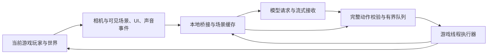

# 内嵌 Minecraft 玩家 AI 控制：实现、使用与研究记录

2026-10-05。目标已确认：控制当前内嵌游戏的玩家，不另开机器人账号；**AI 无须读取屏幕截图或监听扬声器，也能通过引擎导出的结构化信息了解当前画面与声音**。项目基线 `d66cb4dfe1214badb88fa52fabf210ff9d795011`。

## 已实现的本地闭环

代码已接入测试启动器：在开发页选择 **3.10.0.420447**，勾选 **允许 AI 控制当前玩家**，启动测试世界。世界加载和摄像机就绪后，界面显示本次会话的 `ai-game.json` 路径。点击 **停止 AI 控制** 可取消队列、递增控制代次；退出前请求游戏线程停止采样与输入，进程结束后删除接口描述文件并关闭连接。没有用户 Python 模组的原版测试世界也会单独挂载辅助包。

接口直接控制这个窗口里的玩家。实现复用原来的 SHA256 固定版本 DLL 和客户端脚本安全执行点，没有安装第二个 EvalFrame 钩子。原始游戏文件、用户模组源码和其他测试会话不需要修改。AI 接口不接受 Python 源码、游戏命令或 `eval`。

宿主实现为 [`ai_game_io.dart`](../lib/development/ai_game_io.dart)，游戏适配器为 [`runtime.py`](../tools/ai_game/runtime.py)，外部 Agent 和测试执行器为 [`client.py`](../tools/ai_game/client.py)。当前提供的是通用本地 Agent 接口；没有内置云模型账号或代替用户选择、调用付费模型。Codex 或其他 AI 可以从命令行读取观测、提交动作，模型适配器也可以使用下面的双向标准流。

在仓库根目录运行（替换路径为界面实际显示的路径）：

```sh
python3 tools/ai_game/client.py --descriptor /path/to/ai-game.json --observe
python3 tools/ai_game/client.py --descriptor /path/to/ai-game.json --stream --hz 5
python3 tools/ai_game/client.py --descriptor /path/to/ai-game.json \
  --test tools/ai_game/examples/look-test.json --report /path/to/test-report.json
```

`--stream` 的 stdout 输出结构化观测、声音/界面/模组日志事件和动作回执；stdin 接受每行一个完整 JSON，例如：

```jsonl
{"id":"turn_1","action":{"op":"look","pitch":20,"yaw":90}}
{"id":"walk_1","action":{"op":"move","left":0,"forward":1,"duration_ms":600}}
{"id":"slot_1","action":{"op":"select_slot","slot":0}}
{"type":"stop"}
```

AI 可在生成后续动作时让前一条先执行。网络分片或未闭合的 JSON 不会执行。队列最多 8 条，持续动作最多 1500 ms，动作开始前有 1–2000 ms 的有效期；因此不应一次发送几分钟的动作。长期计划保留在 Agent，看到回执后继续补充。`move.left` 为向左、`move.forward` 为向前，向量会被游戏归一化；停止用控制协议或解除输入，不能用 `(0,0)` 冒充释放。

底层协议是 **UTF-8 NDJSON**，绑定 `127.0.0.1` 的随机 TCP 端口。描述文件含一次启动有效的 Agent token，游戏使用另一个 token；macOS 文件权限为 `0600`。Agent 首包为 `{"type":"hello","role":"agent","protocol":1,"token":"…"}`，然后读取 observation 的 epoch，发送 claim，取得 generation。action 和 heartbeat 都必须携带这两个值。最多一个 Agent 控制连接，心跳间隔建议 500 ms；2 秒没有续租、世界/维度变化、热重载、断线或手动停止都会使旧动作失效。heartbeat 必须独立于模型推理。`completed` 仅表示动作执行器完成，**测试通过还需要新状态或事件的断言**。

观测现在包括玩家位置、角度、生命、背包，摄像机位置/朝向/FOV/视角模式，准星方块及其类型，8 条以相机为起点的射线结果，顶层界面名称，声音播放请求、音乐请求、界面进出事件和模组日志。射线排除当前玩家，只输出第一个其他碰撞，避免将被墙遮挡的后续命中当作可见对象。这是稀疏几何采样，不能证明完整画面或像素可见性；贴图、着色器、动画外观、所有 UI 控件/文字、最终声音是否出声及音质仍未覆盖。字段 `coverage` 明确标注这些边界。

动作包括 `move`、`look`、`jump`、`wait`、`select_slot`、`use`、`dig`、`place`、`attack`。后 3 项检查执行当时的准星目标，`dig/place` 参数为整数 `x/y/z/face`，`dig/use` 还需要 `duration_ms`，`attack` 使用字符串 `entity_id`。挖掘使用当前玩家的原生开始/持续/停止链路；停止接口实际为 `(x,y,z)`。放置、攻击、使用物品和生存模式耗时仍需在对应物品/实体测试场景中验收；不能因为导出函数存在就认定所有玩法兼容。

### 当前实际限额

| 链路 | 实现中的默认值/上限 |
| --- | --- |
| 游戏观测 | 默认 5 Hz，可请求 2/5/10 Hz；采样开销超标连续两窗口后降频，稳定 10 秒再尝试恢复 |
| 游戏采集 | 每次最多 8 条射线，范围 16 格；背包每秒更新；客户端 tick 执行动作；网络最多每 50 ms 轮询 |
| 游戏 JSON 帧 | 最大 16 KiB；全量小快照，无依赖前帧的 delta |
| 游戏出站 | 96 KiB/s 持续、128 KiB 突发；待发缓冲 64 KiB |
| 声音/界面事件 | 50 ms 合批、单批 4 KiB、16 KiB/s；队列/预算溢出输出 event_gap |
| Agent 动作 | 每条 1 KiB、最多 8 个未完成动作、最多 16 条/s、动作字节 7 KiB/s，另留控制空间 |
| Agent 模型视图 | 默认每 2 秒最多 4 KiB 的 `model_update`；保留完整 JSON，删减时标注 truncated/omitted_events；回执即时输出 |
| 阻塞/租约 | 写入最长等待 2 秒；控制租约 2 秒；停住的游戏线程恢复后先检查有效期 |

以上尺寸是 UTF-8 字节，**不是精确 token 数**。具体模型的 tokenizer、请求数限额和推理取消需要由模型适配器落实。原 [`transport_budget.json`](../tools/ai_game/transport_budget.json) 保留为更完整的设计草案，仍标为 `proposed_not_wired_to_runtime`；其四字节帧头、delta、分块快照和 tokenizer 预算不是当前实现。本文这张表才是当前运行行为。

### 验证方法与边界

`test/live_ai_game_smoke.dart` 只在显式设置 `MCDEV_LIVE_AI_GAME=1` 后运行。它拒绝活动开发目录，并复制游戏和 Wine 到独立容器；真实运行的观测用于验证旋转、位移、声音、选槽和挖掘后原位置为空气，再加载独立的只读移动日志模组检查模组响应。测试产物写入调用者指定的隔离根目录。无需截图来完成这些断言。

SDK 文档工具目前只有 3.9 快照，3.10 的可用性以实测为准。跨版本、Windows 本机、未加载的资源、复杂原生 UI、视觉效果和实际音质不会自动判定通过。性能数据是本机 Wine 的观测，不能当作通用 FPS 保证；目标 p95 0.5 ms 是降频阈值，并不表示已经达到。

2026-10-05 在 OpenGL 和 Metal 路径中，**功能断言通过，包含退出检查的完整实机测试仍失败**。见 [3.10 实机证据](research/ai-game-control-310-live.json)：当前玩家水平移动 2.20 格，挖掘位置随后读到 `minecraft:air`，收到 `step.snow` / `dig.snow`，服务端测试模组记录了 `AI_FIXTURE_MOVED`，独立 Python 测试执行器的 3 项断言通过。最新 Metal 运行保存的 3 个快照分别为 2497、2653、2719 字节，自动降至 2 Hz；对应窗口内适配器 tick 开销 p95 为 0.933–3.147 ms，窗口最大采样耗时最高 9.754 ms。此数据不包含原有热重载文件轮询、整个游戏帧或云模型延迟，未做 FPS 对照基准。

退出时桥接器已确认停止采样与输入，但引擎随后发生原生崩溃，退出码为 3。两组 OpenGL 对照分别关闭 AI、以及进一步不加载测试模组且不注入 Python 重载 DLL，仍复现退出崩溃（退出码 5 / 3）。因此该故障可独立于 AI 适配器复现，根因尚未定位，不能声称整个生命周期验收通过。实机测试保留退出断言，报告分别记录 `functional_passed`、`clean_shutdown`、`native_crash` 和 `exit_code`；不会把退出崩溃改成通过。

离线验证：38 项 Flutter 协议/热重载/界面测试、13 项 AI Python 测试和 7 项既有 Python 重载测试通过，修改范围的 Flutter 分析通过，macOS Release 构建通过。模型账号尚未接入，以上实测使用确定性 Agent/测试执行器。

实机复现使用 `MCDEV_LIVE_AI_GAME=1`，并显式指定 `MCDEV_LIVE_AI_GAME_ROOT`（独立目录）、`MCDEV_LIVE_AI_GAME_SOURCE`（已安装游戏根目录）、`MCDEV_LIVE_RELEASE_ASSETS`（Release 的 flutter_assets）和 `MCDEV_CHROME_CLIENT_APP`（Release app），然后运行 `flutter test --no-pub test/live_ai_game_smoke.dart --reporter expanded`。加 `MCDEV_LIVE_AI_RENDERER=metal` 使用 Metal；加 `MCDEV_LIVE_AI_BASELINE=1` 关闭 AI 做同模组对照，设为 `vanilla` 则清空用户模组选中列表并不注入 Python 重载 DLL。所有变更限于调用者指定的隔离目录。

## 前期研究的结论与边界

可行性较高，已有启动、隔离会话、辅助行为包和 Python 安全执行点可复用。3.10 静态逆向还找到了 `_player` 中的连续挖掘、停止挖掘、攻击、放置、选槽和使用物品的动态注册路径。第一阶段先验证视听观测，再建立“观测 → 有界动作 → 游戏效果回执”的闭环，最后加入模型。

“实时”应由本地执行器保持连续动作；模型异步规划并提前补充动作。流式输出能够缩短首个动作等待时间，但不能消除模型推理和网络延迟。大量预发指令应成为可撤销、有前置条件的计划，不能变成不可中断的长按序列。

前期研究完成了项目源码阅读、真实 EXE 校验、已有运行时转储的新一轮反汇编、四个 Java 生态项目的源码调查，以及协议设计。以下保留研究记录；其中规划中的能力和预算不能视为当前已经实现，当前行为见上文。

## 无截图的画面与声音感知

### 感知目标

向模型提供当前玩家的视听场景描述，例如“画面左侧有树，准星指向石头，背后传来僵尸叫声，背包界面已打开”。每项信息附证据来源和时间；位置／投影／可见性属于计算结果时明确标记。模型可以据此转头、移动、交互，并从后续观测确认变化。

目标是支持玩法决策的视听语义。要达到逐像素或完整音色的等价描述，还需接入材质、动画、粒子、光照、后处理、自定义 UI、声音资源和混音状态。普通实体／方块列表不具有这些信息；覆盖不到的内容报告 unknown，不能写成“画面没有”或“没有声音”。

### 画面通道

| 观测层 | 导出内容 | 实现依据与待验证点 |
| --- | --- | --- |
| 实际相机 | 相机位置／方向、第一或第三人称、视野角、窗口比例、视口与帧序号 | `GetPerspective()` 的 3.9 文档有三种视角；需继续核对 3.10 实际相机与投影读取。第三人称、动画镜头、缩放不能直接用玩家脚底位置和头朝向代替 |
| 视野内对象 | 方块、实体、物品的类型、姿态、距离、屏幕区域、准星目标 | 先视锥筛选，再在预算内做多点遮挡查询；`PickFacing()` 只覆盖准星，不能代表全屏 |
| 遮挡与视觉状态 | 几何可见、部分遮挡、完全遮挡、视野外、未知；雾／黑暗／隐身等状态 | 文档有客户端 `getEntitiesOrBlockFromRay`，须显式使用包含方块的过滤并禁止穿透；几何射线与玻璃、树叶、透明贴图、烟雾的最终显示不同。未接入渲染证据时标为 `geometry_estimate` |
| HUD 与界面 | 血量、饥饿、快捷栏、提示文字、当前界面、槽位、选中／焦点与可操作控件 | `PushScreenEvent/PopScreenEvent` 可作为界面生命周期信号，但 screen 创建不等于处于最前或可见。原版容器、动态文字及自定义 UI 内容需分别提取 |
| 动态表现 | 破坏进度、挥手、伤害闪烁、天气、粒子、动画阶段 | 从事件／渲染状态补充；未接入的效果不能靠世界方块状态臆测 |

屏幕区域可以用 `[0,1]` 归一化坐标描述，但必须定义原点、裁剪规则和是否只是投影包围框。只投影 3D 包围盒不等于得到真正可见轮廓。几何上可见的对象也可能被黑暗、雾或全屏界面遮住，应分别标注几何可见性与最终显示状态。

视听观测和记忆分别保存：树转到背后以后，当前视野里移除它，空间记忆可以保留“此前观察到的树”。这样 AI 能导航，也不会把记忆中的内容误读为当前画面。

### 声音通道

本轮查证的公开条目仍来自 **3.9 文档快照**：

- `PlaySoundClientEvent`：播放场景／UI 音效时触发，字段为 `name`、`pos`、`volume`、`pitch`、`cancel`。音效名对应 `sounds/sound_definitions.json` 的 key；UI 音效的位置按文档为 `(0,0,0)`。
- `PlayMusicClientEvent`：提供背景音乐 `name` 与 `cancel`，没有上述音效事件那样的位置／音量字段。
- 这些事件不提供完整的开始到结束生命周期、最终混音响度、精确时长或可靠的声源实体 ID。观测器不改 `cancel`；还需处理其他监听器取消播放的情况。

在实际 3.10 原版资源中，本轮确认 `mob.zombie.say`、`mob.creeper.say`、`random.explode`、`step.grass` 等音效定义及资源映射存在。映射应按当前生效的资源包堆叠建立，不能忽略自定义资源覆盖。没有语义标注的自定义音效，先输出资源 ID 和 unknown 描述。

优先用客户端音效事件采集语义，必要时补充底层播放／停止和声道状态：

1. 记录事件 ID、音效 key、游戏 tick、单调时间、事件位置与原始音量／音调。用实际监听者姿态计算相对方向，明确这是坐标推算，不是声音识别。
2. 空间音效用世界位置描述；UI 音效标为非空间音效。不能仅凭 `(0,0,0)` 就断言是 UI，世界原点也可以有真实声源。
3. 区分 `requested`、`playing`、`stopped`、`audibility_unknown`。播放事件不证明最终可听，音效可能被取消、音量关闭、距离衰减、声道虚拟化或资源加载失败。
4. `volume` 不是到达玩家耳边的响度。经底层混音验证后再报告实际可听性；否则保留未知。循环、时长、终止时间若无法取得就不猜测，用事件年龄表示“最近发生”。
5. 听到僵尸音效只能报告“僵尸叫声”；播放指令或自定义模组也可能制造同样音效。缺少关联证据时不据此断言某位置确实存在僵尸。

`v1.6.0` 的 [FMOD 适配源码](https://github.com/MCDFsteve/mcdev_income/blob/v1.6.0/tools/sound/sound_patch.c) 在 `playSound/playDSP/update` 等位置安装 hook，当时只管理无声输出，没有导出音效语义。若复用，需要统一管理这些 hook，不能让两个 DLL 各自覆盖同一入口。底层 Sound／Channel 对象与引擎音效 key 的关联仍需研究，不能直接把对象指针当作稳定声音 ID。

“关闭声音”只把游戏设置中的主音量改为 `audio_main:0`，退出后恢复。感知协议应分别记录游戏混音状态、设备输出是否静音和 AI 观测是否启用。用户关闭扬声器输出时仍可保留引擎声音事件，但不能把“有声音事件”写成“用户此刻听见”。需实测引擎静音是否提前抑制事件／声道创建。

### 视听帧示例

下面是目标协议的示意数据，不是当前已实现或实测的输出。视听用同一个会话时钟，但保留各自采样时间；客户端 tick 不强行等同于渲染帧。

```json
{
  "type": "perception",
  "epoch": "e1",
  "seq": 121,
  "client_tick": 3603,
  "view": {
    "sampled_at_ms": 10240,
    "camera_mode": "first_person",
    "objects": [{"id": "entity:42", "kind": "minecraft:cow", "screen_region": "left", "visibility": "partial", "basis": "geometry_estimate"}],
    "crosshair": {"kind": "block", "id": "minecraft:stone"},
    "ui": {"screen": "hud", "content_coverage": "partial"}
  },
  "audio_events": [{
    "id": "sound:87",
    "observed_at_ms": 10220,
    "sound_key": "mob.zombie.say",
    "semantic_label": "僵尸叫声",
    "semantic_basis": "active_resource_mapping",
    "stage": "requested",
    "relative_direction": "rear_left",
    "direction_basis": "event_position",
    "source_entity_id": null,
    "audibility": "unknown",
    "duration_ms": null
  }],
  "coverage": {"visual_effects": "partial", "custom_ui": "unknown", "audio_mix": "unknown"}
}
```

模型从这一帧可以知道有后左方音效事件，并决定转头观察；不能据此声称已看见或确认了声源实体。协议除快照外还应支持对象进入／离开视野、位置／朝向变化、界面变更、声音开始／停止等增量事件。快速转头时提升视野更新优先级，持续环境声可合并摘要，短促危险音效保持及时传递。

### 优先验证的感知闭环

先做只读视听探针，固定测试对象和音效，逐项验证：

1. 转头后对象在屏幕区域中的变化，以及离开视野后的移除；覆盖第一／第三人称、缩放和窗口比例。
2. 墙后对象不能报告为当前可见；玻璃、部分遮挡、黑暗和界面遮挡分别记录估计边界。
3. 不同方向播放音效，校对事件 key、位置与相对方向；覆盖远距离、取消播放、UI 音效、世界原点、音乐、循环和自定义覆盖。
4. 游戏静音、NOSOUND 输出和正常输出三种状态下分别记录事件与实际播放的关系。
5. 打开背包、切换槽位、出现提示时导出 UI 状态；读取不到的内容明确 unknown。

验收指标增加视野误报／漏报、声音事件覆盖率、方向误差、采样年龄和 UI 覆盖率。通过以后再让模型根据这些 JSON 下达动作，验证“感知 → 决策 → 动作 → 新感知”。

## 当前项目能复用什么

| 代码位置 | 已有实现 | AI 接入时的判断 |
| --- | --- | --- |
| `lib/development/launcher_io.dart:1688` | 装配辅助行为包、校验并注入 Python 重载 DLL | AI 需要独立功能开关与生命周期；当前只在测试项目有 Python 脚本时启用重载桥，无模组世界不能依赖它自动存在 |
| `tools/python_reload/python_reload.c:21` | 拦截专用 Python 空函数，在已有 Python 线程和 GIL 上执行调度 | 复用安全执行点的办法；不要在网络线程、DLL 初始化线程调用游戏 API，也不要安装两个冲突的 `PyEval_EvalFrameEx` hook |
| `tools/python_reload/runtime.py:184` | 每 250 ms 读取一个 `request.json`，只支持 `validate/apply` | 单槽文件轮询不是动作流；不能将频繁热重载当作玩家控制协议 |
| `lib/development/python_reload_io.dart:385` | nonce、epoch、请求 ID、超时和报告校验 | 可复用会话隔离思想；AI 还需要动作去重、队列、代际取消与控制权租约 |
| `lib/development/lan_bridge_io.dart:348` | 服务端 tick 导出 JSON 玩家列表，每 30 tick 一次 | 证明项目已有游戏状态输出路径，尚非完整场景观测 |
| `lib/development/lan_rpc_io.dart:59` | 解析官方启动器控制协议与游戏端口 | 这是启动器控制通道，不是通用玩家操作接口；不往这里猜测发送任意动作 JSON |
| `lib/development/platform/game_runtime_io.dart` | Windows / Mac 会话、路径与启动退出抽象 | AI 桥跟随同一会话管理，不按窗口标题或全局端口绑定玩家 |

仓库已有的 Python 热重载实机记录见 [Python 热重载](python-reload.md)。它证明的是重载能力，不能代替本功能的验收。客户端与服务端即便共享 Python 模块表，也应分别在正确端侧调用引擎 API，通过事件传递必要数据。

## 3.10 逆向结果

### 文件与方法

- 已安装版本：`3.10.0.420447` x64。
- EXE SHA-256：`9be281dbe08bc591336680d5a50f94d87f3c57ee75b3afcb3cabdf03347e0269`，本轮重新计算。
- 映像大小：`0x1d28e000`；已有转储中三处 Python 入口机器码与现有注入器签名匹配。
- 转储来自此前本机捕获的只读代码/数据节。本轮没有重新抓取正在运行的进程；节校验值写入 [静态证据](research/ai-game-control-310-static.json)。匹配签名不等于重新证明整个转储的来源链。
- 先定位字符串，再扫描 RIP 相对引用，结合原始 unwind 区域反汇编动态注册和函数体。原 PE 头的异常目录指向壳的 boot 区域，不能直接当作原始函数边界；本版本原始 unwind 节 RVA 为 `0x19a84000`。
- `_player` 注册区域位于 `0x099a54a0`；可观察到名称、函数地址传给同一注册辅助函数 `0x09a9ac80`。这比单纯字符串存在更强，但仍不证明模块允许导入、参数完整、玩法行为或跨版本兼容。

以下全部是 **RVA**，运行时地址需要加实际加载基址。仅供继续研究，不作为未经验证的调用清单。

| 模块／原生名称 | 已定位的绑定入口 RVA | 本轮证据及限制 |
| --- | --- | --- |
| `_gui.get_input_vector` | `0x097846b0` | 绑定到读取两个浮点分量的函数；不要直接把内部偏移当成稳定 ABI |
| `_player.lock_move_vector` | `0x099a1a10` | 动态注册与包装函数；与 SDK 持续移动接口方向一致，具体封装映射待实机确认 |
| `_player.unlock_move_vector` | `0x0999ff10` | 有对应解除入口，停止控制必须覆盖此路径 |
| `_gui.change_jump_state` | `0x0978aaa0` | 函数体有主线程检查，再进入客户端处理路径；是跳跃候选 |
| `_sunshine_interface.getLocalPlayerPos` | `0x09832990` | 存在动态注册；优先通过公开 SDK 读取位置 |
| `_sunshine_interface.getLocalPlayerRot` | `0x09832ab0` | 读取本地玩家朝向；内部返回格式不能套用公开 SDK 的二元组 |
| `_sunshine_interface.setLocalPlayerRot` | `0x09832e60` | 函数体解析 `ddd`、检查本地玩家，再写两个旋转分量；第三分量用途及单位不可凭此猜测 |
| `_sunshine_interface.setLocalPlayerJump` | `0x09832ca0` | **此绑定函数只见参数解析与返回，未见跳跃状态修改，应按疑似空实现处理** |
| `_player.local_player_start_destroy_block` | `0x099a1630` | 叶包装跳转到 `0x0999dba0`；可继续追踪正常挖掘起点 |
| `_player.local_player_continue_destroy_block` | `0x099a15a0` | 包装解析四个值后调用 `0x099a7fb0`，需确认坐标／面参数与返回值 |
| `_player.local_player_stop_destroy_block` | `0x099a11d0` | 停止挖掘路径；应与开始／继续成组验证 |
| `_player.local_player_attack_entity` | `0x099a19f0` | 包装跳转到 `0x0999de00`；后续区域检查主线程、本地玩家、目标存在和存活，再调用玩家相关虚函数路径 |
| `_player.local_player_build_block` | `0x099a13a0` | 函数体有主线程检查；需核对放置面、手持物、消耗及事件 |
| `_player.local_player_select_slot` | `0x099a0110` | 可研究当前玩家快捷栏选择，需核对槽位范围和同步 |
| `_player.local_player_use_item` | `0x0999f7d0` | 有独立使用物品入口，仍需区分瞬时使用与持续使用 |
| `_player.local_player_release_using_item` | `0x0999f630` | 有释放入口；停止控制要释放使用状态 |
| `_player.local_player_is_using_item` | `0x0999f520` | 使用状态查询候选 |
| 服务端 `player_destory_block` / `player_attack_entity` | `0x09a2a530` / `0x09a29690` | 是另一条服务端操作路径，不能凭名称认定与正常玩家输入等价 |

`player_destory_block` 的拼写按二进制原样保留。部分函数被拆成多个 unwind 区域；单一区域不是完整函数。参数格式字符串部分位于未捕获的可写节，因此本轮不提交猜测的 Python 调用示例。

### 公开 SDK 对照

当前可用查询服务是 **3.9 / BE 1.21.120 文档快照**，对 3.10 的开发指南请求返回不支持。以下是 3.9 文档的能力对照，不是 3.10 实机结论。来源：[网易 ModSDK 文档](https://mc.163.com/dev/mcmanual/mc-dev/mcdocs/1-ModAPI/)。

| 能力 | 文档条目／端侧 | 接入注意点 |
| --- | --- | --- |
| 本地持续移动 | `ActorMotionComponentClient.LockInputVector((left, forward))` / 客户端 | 输入会归一化；`(0.1,0)` 不能作为十分之一移动速度。`(0,0)` 是锁死移动，不是交还控制 |
| 交还移动 | `UnlockInputVector()` / 客户端 | 与停止 AI、用户接管、失联、退出世界绑定 |
| 朝向 | 实体旋转组件 `SetRot((pitch, yaw))` / 客户端 | 单位为度；与内部 `_sunshine_interface` 的参数格式分开验证 |
| 跳跃 | `SimulateJump()` / 客户端原生 UI | 与 `_gui.change_jump_state` 的封装关系待确认；不使用疑似空实现的 Sunshine 入口 |
| 位置、生命、饥饿 | `GetPos()`、`GetAttrValue(attrType)` / 客户端可读 | 附带采样 tick 和数据来源；尚未就绪时返回 unknown |
| 背包 | `GetPlayerAllItems(posType, getUserData=False)` / 双端 | 只传必要的槽位、ID、数量、耐久；不用每帧发送完整 userData |
| 附近实体 | `GetEntitiesAround(entityId, radius, filters)` / 双端 | 限范围、数量；ID 用字符串传输，避免大整数精度丢失 |
| 准星目标 | `CameraComponentClient.PickFacing()` | 分 Entity / Block / None；文档说实体 hitPos 是脚底中心，不能当作真实射线碰撞点 |
| 方块数据 | `GetBlockNew(pos, dimensionId)` / 服务端 | 本次查到的这个名字是服务端接口，不能直接在客户端 tick 调用；客户端方块读取需另核对 |
| SDK 调度 | `OnScriptTickClient` / `OnScriptTickServer` | 文档均描述每秒 30 次；不能直接套用 Java 20 tick/s，也不能假设运行时永不掉 tick |

`Swing()` 文档只承诺播放攻击动作；不能等价为造成伤害。`setMoving/setSneaking/setSprinting` 文档带移动端限制，不能默认适用于当前 Windows EXE。服务端 `PlayerDestroyBlock`、背包写入等可用于开发工具，但正常生存控制需要验证距离、挖掘时间、消耗和事件，不能用它们掩盖本地输入尚未打通的问题。

## 已读取的 Java 生态源码

| 项目与固定提交 | 实际读取的代码 | 可借鉴内容与边界 |
| --- | --- | --- |
| [Axon `78f508dd`](https://github.com/jeremy46231/axon/tree/78f508dd4563dbcede50b6d4079b786de8adddc6) | `agent/AxonAgent.java`、`service/BaritoneService.java`、`service/PlayerService.java` | Fabric 客户端模组，对当前玩家调用主 Baritone；LLM 请求、动作队列、等待／超时状态分开。当前读到的实现等完整响应再入队，并非逐条流式动作协议 |
| [Baritone `62297706`](https://github.com/cabaletta/baritone/tree/622977066159bd47ac9708fb4842dc3a87f2b63c) | `InputOverrideHandler.java`、`BlockBreakHelper.java`、`MineProcess.java`、`PathingControlManager.java` | 本地输入覆盖、持续挖掘、停止、寻路任务仲裁。它本身不是 LLM；Java 的寻路和方块物理代码不能直接搬到网易基岩版 |
| [Mindcraft `dd253cbe`](https://github.com/arclen-dev/mindcraft-ai/tree/dd253cbe4354cd15fd5e4df88e57af3c88f2a4b3) | `src/agent/action_manager.js`、`agent.js`、`models/gpt.js` | 中断挖掘、取消采集、停止寻路／战斗、超时与恢复；属于 Mineflayer 外部客户端方案，不是控制现有窗口的 Fabric 模组。所查模型适配路径等待完整结果 |
| [Voyager `55e45a88`](https://github.com/MineDojo/Voyager/tree/55e45a880755d0c8c66ca7fb5fe7962ac8974f89) | `env/mineflayer/index.js`、`lib/observation/status.js`、`voxels.js` | 状态／背包／周围方块的结构化摘要，动作后反馈与技能复用。`/step` 执行生成代码后返回观察；不是实时输入控制环，也不是现有玩家模组 |

直接依据：[Axon 模型请求](https://github.com/jeremy46231/axon/blob/78f508dd4563dbcede50b6d4079b786de8adddc6/src/client/java/app/jer/axon/agent/AxonAgent.java#L354)、[Baritone 输入覆盖](https://github.com/cabaletta/baritone/blob/622977066159bd47ac9708fb4842dc3a87f2b63c/src/main/java/baritone/utils/InputOverrideHandler.java#L81)、[正常持续挖掘](https://github.com/cabaletta/baritone/blob/622977066159bd47ac9708fb4842dc3a87f2b63c/src/main/java/baritone/utils/BlockBreakHelper.java#L47)、[Mindcraft 中断](https://github.com/arclen-dev/mindcraft-ai/blob/dd253cbe4354cd15fd5e4df88e57af3c88f2a4b3/src/agent/agent.js#L233)、[Voyager 环境](https://github.com/MineDojo/Voyager/blob/55e45a880755d0c8c66ca7fb5fe7962ac8974f89/voyager/env/mineflayer/index.js#L152)。

本轮仅研究，没有复制这些项目代码进运行时。Axon 是 GPL-3.0，Baritone 文件声明 LGPL-3.0-or-later，Mindcraft 为 MIT；若以后移植具体源码，应按其许可交付。

## 推荐结构



三层时间尺度分开：

1. **游戏执行层**：每个客户端 tick 推进当前动作，处理失效条件、中断、释放输入。原始运动反馈可按 tick 采集；SDK 事件名义 30 Hz，以实际测量为准。
2. **桥接层**：默认 5 Hz，静止 2 Hz，高动态 10 Hz；无变化时仅保留心跳，受伤、动作结束、死亡、换世界走关键事件通道。大块地图扫描按预算分摊。
3. **模型层**：动作完成、显著变化或计划将耗尽时请求下一段，普通补充间隔先设 2–5 秒；每会话最多一个模型请求运行，受请求数与 token 预算共同约束。反射动作在本地，不等待模型回包。

游戏持续更新的是本地缓存。普通流式 HTTP 推理请求的输入在发起时固定，新到的观测不会自动进入正在生成的同一个响应。情况变化时，宿主应使旧代际失效、取消旧请求、用新快照发起下一轮；已执行动作无法因取消响应回滚。

### 频率、数据量与采集预算

初始配置已保存为 [transport_budget.json](../tools/ai_game/transport_budget.json)。**这是待实测的设计默认值，尚未接入游戏运行时，不表示当前应用已经按此限流。** 字节预算是紧凑 JSON 编码后的 UTF-8 字节数；`1 KiB = 1024 B`，不能用字符数或 Dart 字符串长度代替。总带宽还计入每帧 4 字节的长度头；后续若启用压缩，仍校验解压后的大小。

| 数据通道 | 初始频率／触发方式 | 单次目标 | 单次硬上限 |
| --- | --- | --- | --- |
| 静止状态增量 | 2 Hz；无变化不发状态空包 | 1 KiB | 2 KiB |
| 行走／一般探索 | **5 Hz** | **4 KiB** | 8 KiB |
| 战斗／快速转头／密集变化 | 10 Hz，带宽与采集预算允许时 | 6 KiB | 16 KiB |
| 普通音效／UI 变化事件 | 最多等待 50 ms 合批；没有事件不发 | 0.5–2 KiB | 4 KiB／批 |
| 受伤、死亡、停止、换世界、动作终态 | 下一个可运行 tick 处理并优先提交，不等待状态周期 | 0.25–1 KiB | 4 KiB／批 |
| 初始／重连／缺基线快照 | 按需；有变化时可每 10 秒做一次检查点 | 16–32 KiB／快照 | 64 KiB 总量，分片各不超过 16 KiB，最多 8 片 |
| 宿主发给模型的观测摘要 | 计划需补充时，普通间隔 2–5 秒 | 2–6 KiB | 12 KiB 且最多 2,000 输入 token，取更严格者 |
| 模型动作交给游戏 | 完整动作校验成功后提交；最多每批 4 条 | 0.15–0.5 KiB／条 | 1 KiB／条，4 KiB／批 |

关键事件优先意味着调度优先，不能保证在暂停、卡顿或网络阻塞时仍于某个固定毫秒内送达。游戏内的停止和控制权回收由本地执行器先做，不能依赖事件先发到模型。

**整条连接的预算：** 游戏 → 宿主持续不超过 **96 KiB/s**，令牌桶突发容量 128 KiB。其中状态可用 64 KiB/s，普通事件预留 16 KiB/s，关键事件预留 8 KiB/s，快照预留 8 KiB/s；调度器先保障有积压的高优先级事件，再借用空闲额度。10 Hz × 6 KiB = 60 KiB/s 是状态目标，10 Hz × 16 KiB 只是逐包上限组合，不能绕过总预算。快照分片允许与实时事件交错，避免整份快照挡住停止回执。

宿主 → 游戏持续不超过 **8 KiB/s**，其中至少 1 KiB/s 预留控制／取消／心跳；突发容量 16 KiB。普通动作同时满足每秒最多 16 条、最多 8 条待执行和最多 1 条活动动作的约束；额度不足就返回背压，不能悄悄丢弃已接受的动作。`stop/cancel` 走独立控制优先级，不占普通动作队列的入队名额。

**模型侧单独控制：** 本地每秒 5–10 次更新不等于每秒调用模型 5–10 次。宿主合并最新状态、任务相关对象和事件后再发一次摘要。默认每会话最多 1 个运行请求，每滚动分钟最多 30 次请求、60,000 输入 token；单请求完整输入（系统说明、工具定义、历史与观测合计）最多 8,192 token。实际发出前按所选模型的 tokenizer 校验，不能按“字节数除以 4”判断中文 JSON 的 token。达到任何上限就延后普通重规划，并在当前技能不能继续时停止；这些阈值可随模型速度与费用调整。

危急变化可以突破普通 2–5 秒间隔，但仍计入滚动总预算。同一 250 ms 内的相关事件合并成一次重规划，10 秒内最多因危急事件取消重启模型请求 2 次；超过时由本地处理器停止／避险并积累新观测，避免持续取消导致模型始终产不出完整动作。

**采集开销比网速更需要约束：**

- 每个可运行客户端 tick 只做必要控制和轻量状态读取；视锥筛选、方块查询、射线与可复制快照的准备共用 **0.35 ms 的采样软预算**，桥接及动作调度总增量开销先以 **p95 ≤ 0.5 ms/tick** 为目标。
- 射线最多 8 次／tick、方块最多 64 次／tick；时间预算和数量预算任一耗尽即延后低优先级采样。每包最多 32 个实体、48 个方块组，优先当前目标、近处威胁和准星附近。
- 单个 SDK 调用不可被这个预算中途抢占，因此它不是硬实时保证。记录单调用耗时与累计超支；若某类调用本身太慢，减少调用频率、缩小范围或改用引擎缓存。
- 游戏对象仅在所属线程读取；离开线程前复制成有界的普通值。网络线程不调用游戏 API；JSON 编码尽量移到宿主／原生工作线程。若仍在游戏线程编码，也计入总开销。
- 位置与朝向在本地控制层保留精度；模型摘要通常保留位置 2 位小数、角度 1 位小数。方块坐标仍是整数，精确瞄准和碰撞不依赖模型摘要的舍入值。
- 重用静态资源字典，按块／实体字段发送增量；库存、UI、音效定义没有变化就不重复。第一版 loopback 小包不开压缩，先避免额外 CPU 与延迟；后续压缩方案单独测。

**背压和过载：**

- 普通状态只保留一份未发送的最新合并结果，超过 250 ms 的待发状态重新采样；合并发生在分配线上的 `seq/base_seq` 之前。已发送／部分写入的帧不替换，保证增量基线连续；缺基线明确重取快照。
- 总待发队列限制为 256 KiB，其中关键事件最多 32 KiB、普通事件最多 64 KiB、快照最多 64 KiB，其余用于当前状态与协议元数据。普通重复环境音可合并计数／时间范围，但不同声源、不同语义和重要事件不能只按音效 ID 合并。
- 带宽不足先缩减远处对象和地图细节，再降低状态频率，不截断任意 JSON 字节。每帧报告 `coverage/truncated/dropped_event_count`，省略不代表对象消失。分片快照以 `snapshot_id/part_index/part_count` 组装，校验完整后原子替换对应范围的基线；缺片继续用旧基线并请求重取。
- 关键事件队列溢出或最老关键事件积压超过 250 ms 时，停止新动作、标记连接降级并请求恢复同步；有限队列无法保证无限事件积压永不丢失，必须显式报告缺口。
- 每 2 秒评估采样开销、队列年龄和帧耗时。连续两窗超预算、队列 p95 超 150 ms，或可用帧耗时相对基线恶化 10% 时，依次缩减地图扫描、远处对象、遮挡更新，再把 10 Hz 降为 5 Hz、2 Hz；稳定 10 秒后逐级恢复。帧耗时比较只用于发现负载，不能把所有场景波动都归因于桥接。
- 心跳间隔 1 秒、租约 2 秒，独立于模型推理。心跳表示宿主／游戏桥健康，不要求模型每 2 秒回答；恢复暂停时先清理已过期控制。

本轮使用 [示例载荷](research/ai-game-control-payload-examples.json) 实际计算了紧凑 UTF-8 JSON 大小：[测量记录](research/ai-game-control-payload-sizing.json)。静止示例 462 B，8 个实体＋12 个方块组为 2,738 B，16＋24 为 5,026 B，32＋48 为 9,602 B；8 条音效事件为 1,661 B，单动作 155 B。最后一种状态虽然低于 16 KiB 单包上限，若连续 10 Hz 发送就会超过状态带宽预算，必须缩减或降频。**这些仅是合成载荷的编码大小，不是实机带宽、SDK 耗时或帧率测试。**

视听探针完成后，在静止、探索、快速转头、密集实体和音效爆发场景分别测 p50/p95/p99 的采集耗时、实际包大小、队列年龄和事件延迟，再调整默认值。现有 `performance_patch.dart` 适配的是 3.8，不能直接拿其游戏偏移当作 3.10 性能采样依据。

### 游戏与宿主的传输

推荐主路径：专用原生桥负责 loopback TCP I/O 和有界收发队列，消息体为 UTF-8 JSON，外层用明确长度分帧。游戏 tick 只消费队列／发布快照，不等待网络。模型 HTTP、密钥、SSE 解析放宿主。

普通模组内直接 `socket/threading` 是否能导入、能否在当前 3.10 环境运行尚未验证，不能预设成立。首个隔离探针可用现有文件路径确认数据和动作语义；确认后替换成原生传输。若 SDK 和普通 Python 已足够，减少 hook 依赖；若需要原生扩展，利用已验证注入与安全点，增加专用原生队列函数，避免逐帧重新执行任意 Python 源码。

连接只绑定本机、每会话独立身份；认证随机值由宿主掌握，不进入模型上下文。游戏退出／换世界产生新 epoch；所有旧消息失效。队列满时明确拒绝或返回额度，不能悄悄丢失动作。观测可合并旧快照，动作结果和危险事件要单独可靠传递。

### 观测 JSON

“游戏转成 JSON”具体是提取玩家、附近世界和动作状态，不是把窗口图像或整个世界存档塞进 JSON。基本规则：

- 首次／重连发完整局部快照；随后发增量，标明 `seq/base_seq`。缺基线就请求新快照。
- 区分未加载、不可见、未扫描与空气；地图更新附维度、范围、来源、采样 tick，分批扫描不可假装同一瞬间完成。
- 模型接收附近可交互目标、障碍摘要、威胁、背包与执行结果。本地寻路可以用更详细的体素缓存。
- 不把半径 16 的整个立方体每帧逐方块查询：那是 `33³ = 35,937` 格。先给查询设置每 tick 数量／耗时预算，再测精度与开销。
- 观察模式明确是客户端可见范围还是开发模式的服务端额外数据，避免把穿墙／未加载信息当作玩家看到的内容。

示意快照，数值仅演示协议，非实测：

```json
{"v":1,"type":"observation","session":"s1","epoch":"e1","seq":120,"client_tick":3600,"kind":"snapshot","player":{"position":[10.5,64,20.5],"rotation_deg":[0,90],"health":20,"selected_slot":0},"inventory":[{"slot":0,"id":"minecraft:oak_log","count":2}],"targets":[{"id":"block:0:12:64:20","block":"minecraft:oak_log","position":[12,64,20],"visibility":"visible"}],"execution":{"generation":7,"active_action":null,"queue_free":8}}
```

### 模型流式下发 JSON

优先设计为“一条完整 JSON = 一条提交单元”。文本模型可约定 **NDJSON**（一行一个 JSON 对象）；工具调用模型则等待供应商明确的单次调用完成事件。必须先验证整条消息与动作参数，再入队。

- SSE 是模型服务输出的封装，不等于应用消息边界；先正确解析 SSE，再拼接模型文本。UTF-8、JSON 转义字符串和对象都可能跨网络包。
- 不因为读到某个 `}` 就直接执行半个工具调用；完整 JSON、schema、前置条件、动作 ID 与代际检查都通过才提交。
- 每条已提交动作独立成立。后面一条格式错误不会让前面真实执行过的动作回滚；大计划不是事务。
- 禁止动作层解释任意 `eval`、Python 源码或任意游戏命令；只开放固定动作集合与参数。模型只输出意图，宿主补齐真实会话信息和执行时限。

示意模型内容流（下面每一行独立提交；第二条可在第一条开始后才生成）：

```jsonl
{"v":1,"type":"action","generation":7,"id":"a1","based_on":120,"op":"look_at","args":{"position":[12.5,64.5,20.5]},"start_within_ms":1500,"max_run_ms":600}
{"v":1,"type":"action","generation":7,"id":"a2","based_on":120,"after":"a1","op":"mine_block","args":{"position":[12,64,20],"expected_block":"minecraft:oak_log"},"start_within_ms":1500,"max_run_ms":8000}
{"v":1,"type":"plan_end","generation":7}
```

`start_within_ms` 由宿主接受消息时开始，以宿主单调时钟计时，不比较两台机器的绝对时钟。`max_run_ms` 限制启动后的执行时间；动作开始时还要验证观察年龄和当前状态。`after` 必须指向同代际中已知且成功完成的动作；父动作失败／取消时，依赖动作也取消。`plan_end` 结束本次生成，不是开始执行的开关。

宿主回执至少包含 `accepted / started / progress / succeeded / failed / cancelled / expired`、动作 ID、当前 tick、结果观测序号与具体原因。`accepted` 只表示入队，不能表示成功。

```json
{"v":1,"type":"action_result","generation":7,"id":"a2","status":"failed","reason":"target_changed","observation_seq":132}
```

### 提前发布大量指令的执行规则

采用滚动计划：可保留较长的高层目标列表，实际可执行队列有额度。原始按键／移动只安排短时窗口，起步 0.5–2 秒；挖掘／寻路等技能可执行更久，但每 tick 重新检查目标、距离、工具、碰撞和取消状态。

- 单一动作仲裁器管理移动、视角、手部和容器操作，避免两个请求同时争夺角色。
- 只开放一次一个世界修改动作；精确需要的“边走边看”由组合技能处理。
- 重复 `id` 且载荷一致只重发结果，不重做攻击／放置；同 ID 不同内容拒绝。新 epoch 不重放旧动作。
- 重规划时先递增 `generation` 并作废旧队列，再取消旧模型请求。即使旧网络回调晚到，也无法重新取得控制权。
- 人工接管、断线、lease 到期、死亡、菜单暂停、切换维度／世界、运行异常时，解除移动、停止挖掘、释放使用物品。世界暂停时 tick 看门狗不会运行，必须在恢复首 tick 先核对墙钟经过时间并停止旧动作；进程暂停期间不能宣称能执行游戏线程清理。
- 遇到危险时，本地处理器按已实现能力停下／避险，并将事件上报。不能假设一条“前进两秒”在环境改变后仍然合理。

## 落地顺序与完成标准

| 阶段 | 产物 | 必须观察到的结果 |
| --- | --- | --- |
| 0. 只读视听探针 | 带覆盖率和采样时间的 `view / ui / audio` JSON | 转头／遮挡／界面变化可识别，音效方向可校对，播放请求与实际可听性分开；未知内容不伪装成已知 |
| 1. 隔离能力探针 | 3.10 专用辅助包与采样记录；每次只测一类动作 | 当前玩家的 ID／位置／朝向／背包可读；移动后坐标变化；停止后不继续移动；跳跃确实产生离地过程。核对未公开 `_player` 模块是否可访问与函数参数 |
| 2. 本地 JSON 桥 | 独立于热重载的会话、传输、队列和动作状态机 | 碎包／粘包、重复 ID、满队列、旧 generation、断线、换世界与暂停恢复都保持可解释的结果；错误线程调用为零 |
| 3. 正常交互 | 瞄准、选槽、持续挖掘、放置、使用／释放与攻击 | 挖掘耗时、工具耐久、掉落、库存消耗、目标距离和游戏事件符合正常玩家行为；停止确实终止进行中的操作 |
| 4. 模型接入 | 供应商无关的流式适配、分条校验、观察摘要 | 第一条动作在整轮响应结束前开始，模型重规划后旧动作不复活；无需给模型任意代码执行能力 |
| 5. 技能与导航 | `move_to / mine_block / collect / craft` 等本地技能 | 先完成“走到一棵树旁 → 挖一块木头 → 拾取 → 放置”闭环，再扩展合成、复杂寻路和战斗 |

建议新增位置：`lib/development/ai_game_session_io.dart` 管会话，`ai_game_protocol.dart` 管消息与校验，`ai_game_controller.dart` 管队列与代际，`tools/ai_game/` 管游戏侧桥和原生适配；通过 `launcher_io.dart` 启停，避免把 AI 逻辑继续塞进重载器。

需要记录 `观测采样 → 宿主收到 → 模型请求 → 首条完整动作 → 入队 → 首个效果 → 完成确认` 各时间点。分别统计 p50/p95、超时率、重复执行数、游戏帧耗时与 token 用量；不要把“首个 token 延迟”报告成“首个动作延迟”。Mac/Wine 与 Windows 原生分别验收。

第一阶段最值得先做的实测是：**读取位置 → 移动 300 ms → 解锁 → 再读位置 → 验证停止**。它能同时验证采集、输入、主线程、协议与控制权回收；然后再测正常挖掘链。合成／容器交易是后续独立难点，不能用直接改背包替代。

## 本轮产物与复现

- [只读调查脚本](../tools/ai_game/inspect_310.py)：标准库生成 JSON，额外安装了 Capstone 的环境可输出带字符串注释的反汇编。只读游戏文件，不注入、不改游戏、不执行找到的函数。
- [3.10 静态证据](research/ai-game-control-310-static.json)：EXE／节哈希、Python 签名、字符串引用和动态注册候选。
- [上游版本记录](research/ai-game-control-upstreams.json)：本轮实际克隆并阅读的四个固定提交。
- 本机完整研究缓存：`build/ai-game-research/`，不纳入版本控制；包含上游源码和 `3.10-static.asm.txt`。

```sh
python3 tools/ai_game/inspect_310.py \
  --exe '/path/to/3.10.0.420447/Minecraft.Windows.exe' \
  --sections '/path/to/captured/runtime-3.10' \
  --output build/ai-game-research/3.10-static.json
```

有 Capstone 时追加 `--disassemble`。原始游戏二进制与内存转储不随仓库分发。脚本只识别本轮固定版本；运行时可调用性、Python 精确签名、正常生存行为、传输性能与其他版本兼容仍待上表的隔离验证。

## 3.10 生存存档实机演示

`test/live_ai_survival_demo.dart` 在独立开发根目录启动 3.10.0.420447。演示存档为生存模式、和平难度、种子 `1`。本地 `tools/ai_game/client.py` 只读取 JSON 观测并下发完整 JSON 动作：定位橡木、移动、挖掘 5 秒以内、核验原木掉落和背包，然后请求 `oak_planks` 与 `crafting_table` 两个受限配方。每步以游戏方块状态、服务端回执及后续背包观测为准；动作 ID 跨客户端连接唯一。

`craft` 是演示行为包 `tools/ai_game/fixtures/crafting_behavior/` 的**服务端材料交换**：校验单人、生存模式与真实背包，消耗 1 根橡木原木生成 4 块木板，再消耗 4 块木板生成 1 个工作台。它没有操作原版合成界面，因此不能证明 AI 已能点击原版 UI 或测试原版配方布局。当前 JSON 画面覆盖是稀疏射线、准星和界面名称；声音是播放请求事件，不能代表完整像素画面或实际可听波形。死亡界面的重生控制也尚未加入协议。

本次实机回执及前后库存位于持久演示目录的 `demo-report.json`；存档在同目录的 `world-export/`，并复制到该目录独立 Wine 前缀的 `minecraftWorlds`。运行测试需要显式设置 `MCDEV_AI_DEMO=1`、`MCDEV_AI_DEMO_ROOT`、`MCDEV_LIVE_AI_GAME_SOURCE`、`MCDEV_LIVE_RELEASE_ASSETS`；重进同一存档再设置 `MCDEV_AI_DEMO_RESUME=1`。演示测试不访问日常开发目录的存档。
